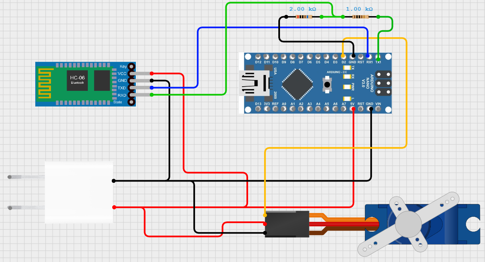
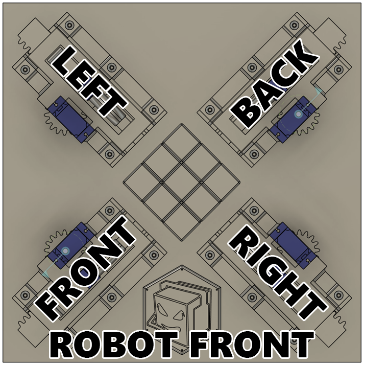

# Rubik's Cube Robot: wiring and Bluetooth guide

How everything is wired, worked out from `Arduino/Config.h`, `Arduino/Calibrations.info`,
`README_resources/wires.png` and `README_resources/servodef.png`. After that, the places
where the Bluetooth link is most likely to fail, and how to fix each one.

## Wiring map

**Board:** Arduino Nano. **Power:** a 5 V, 3 A (or more) wall adapter feeds everything.
Each power rail goes straight from the adapter to each part.

### Power

| From adapter | Goes to |
|---|---|
| **+5 V** (red) | Nano **5V** pin (not VIN), HC-06 **VCC**, red wire of every servo |
| **GND** (black) | Nano **GND**, HC-06 **GND**, brown wire of every servo |

### Bluetooth (HC-06): on D11 / D12

The HC-06 now uses SoftwareSerial on **D11 / D12**, like the car projects, so **D0/D1 stay
free for USB**. The original project used D0/D1, and the diagram above still shows that.

| HC-06 pin | Connection |
|---|---|
| VCC | +5 V from the adapter |
| GND | Common ground |
| **TXD** | Nano **D11** (Arduino RX), direct wire |
| **RXD** | Middle of a voltage divider: Nano **D12** (Arduino TX) → **1 kΩ** → **HC-06 RXD** → **2 kΩ** → GND (≈3.3 V) |
| KEY, STATE | Not connected |

- **Settings:** the pins and the baud rate (**9600**) are in `Arduino/Config.h` (`BT_RX_PIN`, `BT_TX_PIN`, `BT_BAUD`).
- **Commands:** the robot accepts commands from the phone **and** from the USB Serial Monitor.
- **Replies:** every reply goes to both.
- **Uploading:** you can upload with the HC-06 still plugged in.

### Servos (signal wires, from `Config.h`)

Front, Left, Right and Back are as seen from the robot's logo side.

| Grabber | Slider (the servo with the gear) | Spinner (the servo with the grabber) |
|---|---|---|
| **Right** | D4 | D5 |
| **Left** | D17 = **A3** | D19 = **A5** |
| **Front** | D16 = **A2** | D15 = **A1** |
| **Back** | D3 | D2 |

`Calibrations.info` lists the same pins, so the code and the wiring the calibration was
done on agree.

## Where the Bluetooth link can go wrong

### 1. The servos and the HC-06 share one 5 V supply

This is the most likely cause.

- **The sliders stall on purpose.** The Arduino README says the L state means "fully
  pressing into the cube, stalling". A stalled micro servo draws roughly 0.6–1 A.
  Commands like `RLLL` and `FLBL` stall two at once, while other servos move.
- **All eight servos start at the same moment.** When a command arrives, `loop()`
  reattaches all eight servos together, and each one jumps to its position. That surge
  lands on the same 5 V wire as the HC-06 and the Nano.
- **What a voltage dip does:**
  - The HC-06 browns out and drops the Bluetooth link, or the Nano resets.
  - You'd typically see the robot disconnect, or stop answering, **right after you send
    a command**, or in the middle of a grip.
  - A Nano reset also prints `Listening for API commands…` and forgets what state it
    was in.
- **Fix:**
  - Put a large capacitor (about 1000 µF) across the servo 5 V and GND, close to the
    servos.
  - Add about 100 µF at the HC-06's VCC.
  - Better still, give the servos their own supply. Keep the grounds connected, and run
    the Nano and HC-06 from a separate clean 5 V, or from USB.

### 2. SoftwareSerial and the servos share the CPU

- **Why:** while the Arduino sends a reply over SoftwareSerial, interrupts are paused for
  about 1 ms per character at 9600 baud. That can stretch one servo pulse, so a servo may
  twitch slightly when the robot answers (`OK`, `BUSY`, `IDLE`).
- **Why it's acceptable:** the replies are a few characters long, so this is usually
  invisible.
- **If you see twitches:** don't send long commands like `HELP` while the robot is moving.
- (The old D0/D1 wiring shared the USB chip instead, which caused upload failures and
  garbled data whenever USB was plugged in.)

### 3. The HC-06's TX signal only just counts as "high" to the Nano

- The HC-06 sends 3.3 V logic, with nothing boosting it. A 5 V Nano needs at least
  0.6 × VCC to read a high: 3.0 V at 5.0 V, and about 3.15 V if the adapter puts out
  5.25 V.
- That margin is tiny. With servo noise on the same ground it can flip bits, which shows
  up as `ERR cmd` or garbage commands.
- **Fix:** a proper logic-level shifter, or a transistor/diode level-up circuit, on the
  HC-06 TX → D11 line.

### 4. The baud rate may not match

- The car project includes an `HC06_BaudFinder` sketch. If this module's baud rate was
  changed with AT commands for the car, it won't match the cube robot's 9600.
- The phone will still connect, because pairing doesn't depend on baud rate. But the
  robot will receive garbage and never reply.
- **Fix:** run the BaudFinder sketch on this HC-06 to check its rate.

### 5. Problems in the phone app (`CubeSolver/`)

- **No newline after commands.** The Arduino reads with `readBytesUntil('\n')` and a
  2-second timeout, so every command waits 2 seconds before it runs. If you send two
  commands within that window, for example Open and then Close, they get joined into
  one line and rejected with `ERR args`.
- **A dropped link isn't noticed.** If the HC-06 resets (see point 1), the read loop
  just ends and the app keeps showing "Connected". Every command after that silently
  goes nowhere, because send errors are ignored.

## Checked and fine

- **Command length:** the longest command the app sends is about 138 characters, under
  the Arduino's 255-character buffer, so long scan sequences aren't being cut off.
- **The divider:** the resistors on the HC-06's RXD are the right values.
